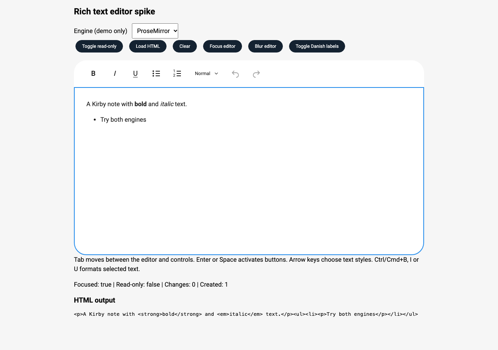
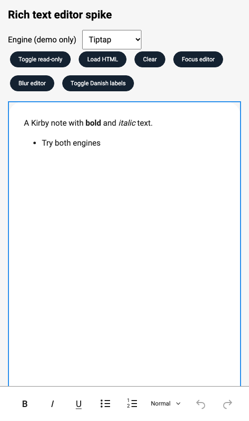

# Rich text editor spike

Composable standalone Angular editor and toolbar components, two internal adapters, and an engine-independent HTML API. This is a technical spike, not a production editor.

## Run the demo

From the repository root:

```sh
npx nx build extensions-angular
npx nx storybook extensions-angular
```

Open **Spikes / Rich Text Editor / Comparison** and use the engine selector. Content is retained when switching; the editor is destroyed and recreated. The **Tiptap** and **Prose Mirror** stories start with their respective adapters.

## Consumer API

```ts
import { RichTextEditorComponent } from '@kirbydesign/extensions-angular/rich-text-editor';
```

```html
<p id="note-help">Use Tab to move between the editor and formatting controls.</p>
<kirby-x-rich-text-editor
  [(value)]="html"
  placeholder="Write a note..."
  [readonly]="false"
  [texts]="editorTexts"
  aria-label="Case notes"
  aria-describedby="note-help"
  (editorFocus)="onFocus()"
  (editorBlur)="onBlur()"
  (editorCreated)="onCreated($event)"
/>
```

The `kirby-x-` selector follows existing extension conventions. `editorCreated` exposes only `{ editor: { focus(), blur() } }`; content is handled through `value` and `valueChange`. Neither engine types nor engine selection are exported from the public entry point.

### Composing the editor and toolbar

The editor includes its toolbar by default. Import `RichTextEditorToolbarComponent` from the same entry point to place the toolbar separately:

```html
<kirby-x-rich-text-editor
  #editor
  [(value)]="html"
  [showToolbar]="false"
  [texts]="editorTexts"
  aria-label="Case notes"
/>

<kirby-x-rich-text-editor-toolbar [editor]="editor" />
```

The required `editor` input takes the Angular component reference, not the limited `editorCreated` event facade. Bind one toolbar to each editor and disable its built-in toolbar when composing separately. The toolbar can be placed elsewhere in the consumer's layout; on narrow screens it still docks above the keyboard when its editor or controls are focused.

Labels, selected formatting, history availability and read-only state follow the connected editor automatically, including runtime updates. Changing `showToolbar` or moving between built-in and separate toolbars does not recreate the editor or clear its content, selection or history. Omitting both toolbars leaves keyboard formatting and supported pasted content available.

The editor exposes read-only `state`, `focused` and `labels` signals plus engine-independent `execute(action)` and `setBlock(level)` methods for connecting controls. Action, block-level and state types are exported without exposing Tiptap or ProseMirror. Toolbar buttons and their order remain fixed in this spike.

The **Separate Toolbar** story demonstrates the toolbar below the editor. **Toggle separate toolbar** switches between the composed and built-in layouts at runtime in either engine.

### Customizing text

`texts` accepts `Partial<RichTextEditorTexts>`; omitted keys keep their English defaults. Pass a new object to update labels at runtime without recreating the editor or changing its HTML:

```ts
import type { RichTextEditorTexts } from '@kirbydesign/extensions-angular/rich-text-editor';

editorTexts: Partial<RichTextEditorTexts> = {
  heading1: 'Overskrift 1',
  heading2: 'Overskrift 2',
  heading3: 'Overskrift 3',
  normal: 'Normal tekst',
  bold: 'Fed',
  boldText: 'F',
  textStyle: 'Teksttype',
  toolbar: 'Tekstformatering',
};
```

All keys are `bold`, `italic`, `underline`, `bulletList`, `orderedList`, `undo`, `redo`, `boldText`, `italicText`, `underlineText`, `heading1`, `heading2`, `heading3`, `normal`, `toolbar`, and `textStyle`. Accessible names and tooltips use the same translated action labels. `boldText`/`italicText`/`underlineText` customize the visible lettering.

Use the existing `placeholder`, `aria-label`, and `aria-describedby` inputs for editor text and help. Keep accessible labels non-empty. The **Danish** story and **Toggle Danish labels** button demonstrate configuration and runtime updates.

Supported HTML: paragraphs, Heading 1–3, bold, italic, underline, unordered and ordered lists, list items, and line breaks. Both adapters normalize unsupported markup through their schemas. HTML is semantically equivalent, not a byte-for-byte persistence guarantee.

### Pasted HTML

Both engines use ProseMirror's schema-based clipboard parser. Only supported document nodes, marks and their declared attributes enter the editor document; an iframe cannot be inserted because neither schema supports it. Pasted `<b>` and `<strong>` elements retain bold formatting and serialize as `<strong>`.

A browser paste-event check in both adapters confirmed that HTML containing bold text and an iframe produced bold text with no iframe in the emitted HTML. No additional filtering code or dependency is needed for this requirement.

Tiptap's pattern-based paste rules are disabled in this spike; they are not needed for HTML formatting preservation. Schema filtering is not a general-purpose security sanitizer for arbitrary HTML elsewhere in an application. Consumers must still secure storage and rendering boundaries.

## Architecture and complexity

The public editor component owns the consumer API, shared state and composition. The internal writing-area component owns engine mounting and teardown, content updates, placeholder, document styles, accessible editor attributes and focus events. The public toolbar component owns the shared Kirby controls and responsive keyboard positioning, binding to the editor's engine-independent state and actions.

The [public-components folder](./src/public-components/) contains the complete editor. Its dependent toolbar and writing area live in [components](./src/components/), with [engine adapters](./src/editor-adapter/) kept separately. Shared public types remain in one file. The toolbar remains exported for composing it with an editor and requires that editor reference; it is not an independent editing surface. The writing area is not exported from the package entry point. This prepares the composition without committing to public template hooks.

Caret scrolling uses ProseMirror's native `scrollThreshold`/`scrollMargin` options in both adapters. The toolbar supplies its measured mobile height plus 16px clearance and observes size changes so the margin follows layout changes, including scrollbars. Typing and keyboard selection use native editor scrolling; focus and visual-viewport changes explicitly request Tiptap's `scrollIntoView()` or the equivalent ProseMirror transaction. There is no custom caret-range measurement or `window.scrollBy` implementation.

The adapter factory defaults to Tiptap; the Storybook wrapper overrides it internally. This one spike story deliberately imports source code so engine configuration stays out of the public API; its lint exception is scoped to that file.

| Concern             | Tiptap                                                    | Direct ProseMirror                                                     |
| ------------------- | --------------------------------------------------------- | ---------------------------------------------------------------------- |
| Setup/schema        | Configure StarterKit; disable out-of-scope features       | Restrict the basic schema, add list nodes and an underline mark        |
| Formatting          | Built-in bold, italic, underline and list toggle commands | Built-in `toggleMark`, `wrapInList`, `liftListItem` and `setBlockType` |
| List switching      | Built in                                                  | A small bridge switches an existing list's node type                   |
| Active state        | Built-in `isActive`                                       | Inspect selection marks and enclosing list                             |
| History             | Built-in undo/redo                                        | Standard history plugin and commands                                   |
| HTML                | Built-in content loading/serialization                    | Standard DOM parser and serializer                                     |
| Angular integration | Same shared component                                     | Same shared component                                                  |
| Mobile              | Same shared viewport-aware toolbar                        | Same shared viewport-aware toolbar                                     |

The adapters do not implement editing, history, list splitting or document transformations from scratch. ProseMirror needs more integration code because it provides primitives rather than a ready-made editor facade. The actual adapter files are **125 lines for Tiptap and 281 for ProseMirror**, including lifecycle, HTML handling, native scrolling and state mapping, but excluding the shared components and contract.

Formatting buttons preserve the selection on pointer activation. Text-style selection restores editor focus after Kirby's dropdown closes. Programmatic content updates do not emit `valueChange` or become undo entries. Engine replacement preserves content, but not the old engine's history or selection.

## Accessibility

The implementation targets WCAG 2.2 AA as an engineering baseline relevant to EU accessibility requirements:

- Named multiline textbox, configurable `aria-label` and `aria-describedby`, and exposed read-only state.
- Named button group and toggle buttons with `aria-pressed`; decorative SVGs are hidden from assistive technology.
- Native buttons support touch, Enter and Space. Kirby's dropdown supplies its existing combobox/listbox and arrow-key/Escape behavior.
- The dropdown uses its supported item-template API to render one native option per item, avoiding nested interactive elements in its default selectable-item markup.
- Tab and Shift+Tab navigate normally, including inside lists; they do not indent lists or trap keyboard focus.
- Visible focus outlines and at least 44px-high toolbar controls.
- Bold/italic/underline: Ctrl/Cmd+B/I/U. Lists: Ctrl/Cmd+Shift+8/7. Paragraph/Heading 1–3: Ctrl/Cmd+Alt+0/1/2/3. Undo/redo: Ctrl/Cmd+Z and Ctrl/Cmd+Shift+Z.

Browser checks exercised Space/Enter activation, keyboard text-style selection, focus restoration, Tab escape from lists, and runtime label updates in both adapters. The existing axe-core checker reported no WCAG A/AA violations in the editor and open text-style popup at the inspected states. No automated test files were added.

Both built-in and separate toolbars were checked at a 500px viewport in both engines: controls remained at least 44px high, open text-style options were at least 56px high, and the caret stayed at least 16px above the docked toolbar. The same accessibility scan reported no selected WCAG A/AA violations in all four combinations. Runtime placement changes preserved the editor DOM instance, content and undo history; separate toolbars followed translated labels and read-only updates.

After extracting the writing area, these checks were repeated with native scrolling. Additional checks covered nested scroll containers, viewport resizing, placeholder visibility, programmatic updates without `valueChange` emission, and one `editorCreated` event per editor instance.

This is **not an EU compliance certification**. Real VoiceOver/NVDA testing, an EN 301 549 assessment, zoom/reflow and forced-colors checks, and physical iOS/Android keyboard testing remain necessary before production use. Responsive screenshots do not prove virtual-keyboard behavior.

## Screenshots

Captured in Chrome at 1280×900 (desktop) and 500×844 (narrow/mobile layout). The narrow layout shows a focused editor with a bottom toolbar; no physical virtual keyboard was present.

|               | Tiptap                                              | ProseMirror                                                   |
| ------------- | --------------------------------------------------- | ------------------------------------------------------------- |
| Desktop       |  |  |
| Mobile layout |    |    |

## Recommendation

Prefer **Tiptap behind the internal adapter**. Its existing commands, active-state queries and HTML handling remove integration work without coupling consumers to the engine. Direct ProseMirror remains a viable replacement, but makes Kirby responsible for more selection/schema integration and its ongoing maintenance. Neither engine has an inherent advantage for this mobile toolbar: the UI is shared and both use ProseMirror underneath.

Keep the abstraction limited to Kirby's actual features. Do not expose the raw editor or add a general-purpose command framework.

## Maintenance and security

Evidence checked on **12 November 2026**. This is dependency due diligence, not a code security audit or a guarantee of future maintenance.

| Concern           | Tiptap                                                                                                                                                                                    | ProseMirror                                                                                                                                                                                                                                                         |
| ----------------- | ----------------------------------------------------------------------------------------------------------------------------------------------------------------------------------------- | ------------------------------------------------------------------------------------------------------------------------------------------------------------------------------------------------------------------------------------------------------------------- |
| Ownership         | Company-backed by [Tiptap GmbH](https://tiptap.dev/privacy-policy), Germany; multiple npm publisher accounts                                                                              | Created and maintained by [Marijn Haverbeke](https://marijnhaverbeke.nl/fund/); checked core packages have one npm publisher account                                                                                                                                |
| Track record      | [Repository](https://github.com/ueberdosis/tiptap) established in 2018                                                                                                                    | Checked core packages first published in 2016; [project](https://prosemirror.net/) remains actively maintained                                                                                                                                                      |
| Recent releases   | [3.33.1 released 10 November 2026](https://github.com/ueberdosis/tiptap/releases/tag/v3.33.1), with multiple preceding releases in October/November                                       | [Model 1.25.13 released 8 November 2026](https://code.haverbeke.berlin/prosemirror/prosemirror-model/src/branch/main/CHANGELOG.md); [view 1.42.9 released 31 October 2026](https://code.haverbeke.berlin/prosemirror/prosemirror-view/src/branch/main/CHANGELOG.md) |
| Security response | [Public policy](https://github.com/ueberdosis/tiptap/blob/main/SECURITY.md): acknowledgement within 48 hours; critical fixes within 24 hours, high within 72 hours, medium within 14 days | Published security fixes in changelogs; no comparable public remediation timetable found in the reviewed sources                                                                                                                                                    |
| Long-term support | Public policy is not a negotiated SLA or a commitment to maintain a particular major version for a fixed number of years                                                                  | Sponsorship and custom support contracts are offered by the maintainer; terms need to be agreed                                                                                                                                                                     |

Tiptap provides a broader organizational backing signal, while ProseMirror has a longer maintenance history and more concentrated publisher ownership. A publisher count is not a contributor count. Neither project's current activity guarantees that it will still be supported in two years. ProseMirror development now happens on Forgejo, so its GitHub mirror alone is not a reliable activity indicator.

### Published vulnerabilities and our locked versions

The following GitHub-reviewed advisories were found when checking 43 root-installed editor packages and helper dependencies against the lockfile. No nested copies of these dependencies were present. **None of the checked versions matched the published vulnerable ranges.** Advisory databases can be incomplete; this does not establish that the editor has no vulnerabilities.

| Advisory                                                                                                    | Package                  | First patched version | Locked version |
| ----------------------------------------------------------------------------------------------------------- | ------------------------ | --------------------- | -------------- |
| [CVE-2026-104847: paste-handling XSS](https://github.com/advisories/GHSA-c8x8-7fp4-3x9w)                    | `prosemirror-view`       | 1.42.3                | 1.42.9         |
| [GHSA-j95f-988m-3j2f: Markdown parsing ReDoS](https://github.com/advisories/GHSA-j95f-988m-3j2f)            | `@tiptap/core`           | 3.30.5                | 3.33.1         |
| [GHSA-cp6q-959q-f8rh: attribute injection](https://github.com/advisories/GHSA-cp6q-959q-f8rh)               | `@tiptap/core`           | 3.30.4                | 3.33.1         |
| [CVE-2025-14284: link XSS](https://github.com/advisories/GHSA-vhrc-hgrq-x75r)                               | `@tiptap/extension-link` | 2.10.4                | 3.33.1         |
| [CVE-2025-8101: prototype pollution/attribute injection](https://github.com/advisories/GHSA-95jq-xph2-cx9h) | `linkifyjs`              | 4.3.2                 | 4.4.0          |

The link extension is disabled in this editor but its package is installed through StarterKit. Scan the complete shipped dependency graph, not just enabled toolbar features. Both adapters depend on ProseMirror, so choosing Tiptap does not remove the need to monitor and update ProseMirror. Advisories without a CVE identifier also matter.

### Production adoption conditions

- Assign a Kirby owner for dependency updates and security response. Monitor CVE/GHSA advisories and scan the lockfile in CI.
- Apply and validate security updates in Kirby and consuming applications. A caret dependency range does not update an existing lockfile or deployed application.
- Agree on supported major versions, end-of-life notice, security notification, remediation deadlines and upstream/transitive dependency coverage with the supplier if contractual assurance is required. Do not assume a paid cloud plan covers the locally embedded open-source editor.
- Review release activity and maintainer responsiveness periodically. Investigate prolonged inactivity in context; stable small modules can legitimately release infrequently.
- Retain the engine-independent API as an exit path, not as a promise that replacing an engine is cost-free.

For this requirement, **Tiptap remains the preferred candidate, conditional on an acceptable support agreement and an owned update process**. Its cloud SOC 2/GDPR statements are not certification of this local Angular integration. No update automation, support contract or full application security assessment was added by this spike.
